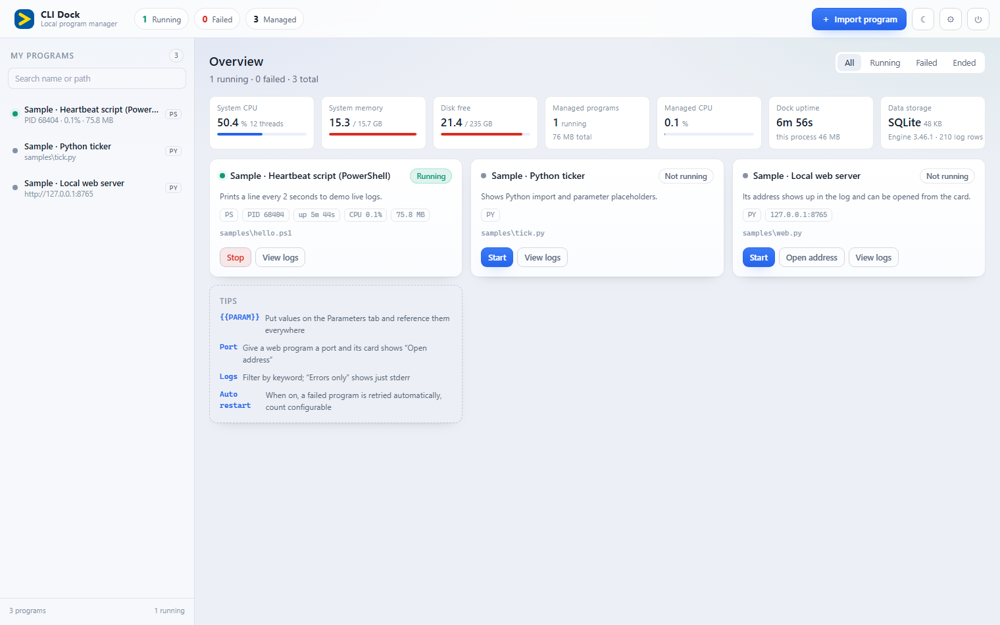

# CLI Dock

**English** | [简体中文](README.zh-CN.md)

One panel for all the command-line programs scattered around your machine: PowerShell scripts, Python tools, batch files, `.exe`, or any raw command. It is built on the same idea as Docker Desktop — except the things it manages are your own local scripts.

No install, no `npm install`, no admin rights. Windows 10/11.



- **Zero npm dependencies** — only Node built-in modules; copy the folder and run it
- **Windows 10/11** — the UI is an Edge app window (falls back to the default browser)
- **SQLite** storage (`data\cli-dock.db`); if the SQLite components are missing it degrades to JSON automatically, and every feature keeps working

## Features

| Capability | What it does |
| --- | --- |
| Program management | Import `.ps1` / `.py` / `.cmd` / `.exe` / any custom command line; remembers path, arguments, working directory, environment |
| Parameter placeholders | Write `{{PORT}}` in the arguments and fill the value in the UI — change parameters without editing scripts |
| Honest status | **Completed** (exit code 0) / **Failed** (non-zero) / **Stopped** (you pressed stop) are three distinct states that never get confused |
| Scheduling | Every N seconds/minutes/hours, daily at fixed times, **weekly on selected weekdays + times**, or run once at a given time |
| Live logs | Follow output while it runs, stdout/stderr colour-coded, searchable, with history of previous runs |
| Load dashboard | Machine CPU, memory, free disk, number and total CPU/memory of managed programs, and Dock's own footprint |
| Quick access | Give a web program a port and its card shows "Open address"; any `http://...` printed in the log is picked up automatically |
| Tray resident | Closing the window does not stop anything: the tray menu can reopen the panel, stop everything, or quit |
| Auto restart | Retry after a failure, with configurable count and interval (can be disabled) |
| English / 中文 | One switch in Settings changes the UI, tooltips, tray menu, and even the system lines in program logs |

## Quick start

1. Download this repository (`Code → Download ZIP`) and extract it to a folder **you can write to** (not `C:\Program Files` — the program creates `data\` next to itself)
2. Double-click **`CLI-Dock.exe`** (or `Launch.cmd`; they are equivalent)
3. On first launch it checks the environment: it installs a private copy of Node.js if needed, downloads the SQLite components if missing, then opens the panel in a browser window

From the command line (better for troubleshooting, you can watch the startup):

```
CLI-Dock.exe                        open the panel
CLI-Dock.exe -stop                  stop the service and the tray
CLI-Dock.exe -Port 7900             start on another port
CLI-Dock.exe -Port 7900 -NoWindow   service only: no window, no tray
```

## Project layout

```
CLI Dock\
├─ CLI-Dock.exe         double-click launcher (ps12exe shell, only calls src\start.ps1)
├─ Launch.cmd           same thing, works without the exe
├─ src\                 program and scripts
│  ├─ server.js         backend (Node built-in modules, no dependencies)
│  ├─ public\           frontend (plain HTML/CSS/JS, no build step)
│  ├─ samples\          three sample programs
│  ├─ lib\              SQLite components (downloaded on demand, not committed)
│  └─ *.ps1             launcher / tray / stop / environment prep / DB host
├─ data\                runtime data (database, logs, generated scripts; created on first run)
└─ icon\                logo sources (svg / ico)
```

**Upgrading never touches your data**: replace `src\` and `CLI-Dock.exe`, leave `data\` alone. To back up, copy `data\` only.

## Importing a program

Click `+ Import program` → pick a file (or type a command) → confirm the runtime type.

| Field | Meaning |
| --- | --- |
| Path / command | Three notations are supported: `C:\x\x.ps1`, `~\Downloads\x.ps1`, `samples\x.ps1` (see below) |
| Arguments | Supports `{{NAME}}` placeholders, e.g. `-Env {{ENV}} -DryRun` |
| Working directory | Empty means "the folder the script lives in" |
| Port | Optional; only web programs need it, and only then does "Open address" appear |
| Stop mode | Kill the whole process tree (default), or ask politely first and force after a grace period |
| Auto start / auto restart | Launch when CLI Dock starts / retry after a failure |

### Three ways to write a path

| Notation | Means | Best for |
| --- | --- | --- |
| `samples\x.ps1` | Relative to the CLI Dock folder | Scripts that travel with the app: the whole folder can move anywhere |
| `~\Downloads\x.ps1` | The user profile | Still valid on another machine with a different user name |
| `C:\tools\x.ps1` | Absolute path | Used as-is |

Paths are normalised when saved (inside this folder → relative, inside your user profile → `~\...`, other drives → absolute). If a path disappears, the card is **outlined in red** and says "path invalid"; fix the path and your parameters and schedule are still there.

## Status semantics

| Status | Meaning |
| --- | --- |
| Running | The process is alive |
| Completed | Exit code 0. Scheduled jobs that do a task and exit belong here — **this is not an error** |
| Failed | Non-zero exit code (the code is shown on the card) |
| Stopped | You pressed Stop |
| Restarting | Currently retrying after a failure, per your auto-restart policy |

## Scheduling

Detail page → **Schedule** tab:

| Trigger | Meaning |
| --- | --- |
| Every N | Seconds / minutes / hours, e.g. every 30 minutes |
| Daily at fixed times | 24-hour clock, comma separated, e.g. `08:30, 17:30` |
| Weekly, selected weekdays + times | Tick any set of weekdays plus one or more times, e.g. Tuesday and Friday at `09:00, 18:30` |
| Once at a given time | Runs once, then disables itself |

Rules:

- If the program is still running when the time comes, that occurrence is **skipped** — instances never stack up
- A one-shot time that has already passed **is not caught up** (so restarting the console never triggers an important job out of the blue)
- Weekly schedules use the local time zone and roll over to the next week automatically
- CLI Dock schedules in memory: it does not use Windows Task Scheduler, so nothing fires while CLI Dock is not running

## Tray

- An icon appears in the notification area after startup. Menu: **Open panel / Open in browser / Stop all running programs / Quit**
- Double-click the icon to open the panel
- Closing the window only closes the UI, **programs keep running**; use the tray's Quit or `CLI-Dock.exe -stop` to stop everything
- Tray log: `data\tray.log`

## Language (English / 中文)

`⚙ Settings` (top right) → **UI language** → `English` or `中文`:

- Takes effect immediately, no restart, no reopening the window
- The choice is stored in the app's own settings (it travels with `data\`), not in browser storage, so a new window or another machine keeps the same language
- It also switches the tray context menu and tooltips (within 3 seconds), the system lines written to program logs (`▶ Command`, `✔ Completed`, …), API error messages, and directory shortcut names
- "Previous run" logs are the original text as it was written and are never rewritten
- To peek at the other language without changing the setting: `http://127.0.0.1:7811/?lang=zh`

## Logs

- The **Logs** tab of the detail page updates live (stdout in white, stderr in red, system lines highlighted) and supports keyword search
- The raw text of each run is kept in `data\logs\app_<id>-<timestamp>.log`, last 30 runs
- The same content goes into the database's `log_lines` table, queryable via `GET /api/db/logs?appId=…&limit=200`
- PowerShell child output is forced to UTF-8; if your script is "UTF-8 without BOM and contains non-ASCII", you get a warning before launch

## Quick access

- With a port set, the card shows "Open address": `http://127.0.0.1:<port>`
- Without a port it still works: the first `http://...` printed in the log is detected and shown

## Data

The primary store is SQLite (`data\cli-dock.db`):

| Table | Contents |
| --- | --- |
| `apps` | Program definitions, parameter values, schedule, last run |
| `settings` | Python / PowerShell paths, stop grace period, metrics on/off |
| `runs` | One row per run: status, exit code, start/end, trigger |
| `log_lines` | Every output line; capped at 200,000 rows, oldest dropped |

- **Automatic migration**: if an old `data\config.json` exists, the first start imports it into the database and keeps a copy as `config.json.migrated-backup`
- **Fallback**: if the SQLite components cannot be loaded (download failed / DLL load failed), storage switches to `data\config.json`; the "Data storage" tile in the overview shows `JSON fallback` and the reason
- Query the database directly:

```
powershell -File src\db-host.ps1 -Db data\cli-dock.db -Request '{"id":1,"op":"query","sql":"select name,status from runs order by id desc limit 10"}'
```

## Moving it to another machine

Copy the whole folder; only two preconditions:

1. **Windows 10/11** (the tray uses WinForms, stop uses `taskkill`)
2. **A folder you can write to** (the app creates `data\`)

Node.js and the SQLite components do not need to be preinstalled — both are fetched on demand (Node from the official zip into your user profile, SQLite from the NuGet package), neither needs admin rights. If both downloads fail you get a clear message and the app keeps working in fallback mode.

Note: `data\config.json` may contain plaintext environment variables. Delete `data\` before handing the folder to someone else.

## FAQ

**Does closing the window stop my programs?** No. The service and the tray keep running. Use the tray's Quit or `CLI-Dock.exe -stop` to stop everything.

**Port 7811 is taken**: `CLI-Dock.exe -Port 7900`, or set `set CLIDOCK_PORT=7900` before starting; `Launch.cmd`, stop and the tray all follow it. If that port belongs to another service, the launcher recognises it and asks you to change ports instead of pretending someone else's page is your panel.

**The exe flashes and disappears**: run `CLI-Dock.exe` from a command line to see the error. Common causes are a folder without write permission, or Node auto-install failing (on a locked-down network set `CLIDOCK_SKIP_NODE_INSTALL=1` and install Node yourself).

**The overview says "JSON fallback"**: the SQLite components did not install. Check the tile tooltip; alternatively place the three files from the official NuGet package `Stub.System.Data.SQLite.Core.NetFramework` into `src\lib\` (`lib\net46\System.Data.SQLite.dll` → `src\lib\`, `build\net46\x64\SQLite.Interop.dll` → `src\lib\x64\`, `build\net46\x86\SQLite.Interop.dll` → `src\lib\x86\`), then run `powershell -File src\lib-init.ps1` to verify.

**Parameter binding errors (e.g. ValidateRange)**: check the values you filled in for the arguments. The launcher turns `-Name value` / `-Switch` / `-Name:value` into properly named parameters and never passes empty values.

**Python not found**: set Python to `py` or to an absolute path in Settings.

**The tray icon vanished**: check `data\tray.log` first; Windows may also have moved it into the hidden-icons flyout.

## Technical notes

- Backend `src\server.js`: Node built-in modules (http / fs / child_process), state pushed over SSE, no framework
  - `GET /api/state`, `GET /api/events` (SSE)
  - `POST /api/apps`, `DELETE /api/apps/:id`, `POST /api/apps/:id/{start|stop|restart|values|schedule}`
  - `GET /api/apps/:id/tail?since=N`, `GET /api/log?file=…`, `GET /api/browse?dir=…`, `GET /api/db/logs`
  - `POST /api/settings`, `POST /api/shutdown`
- Frontend `src\public\`: plain HTML/CSS/JS, no build step, light and dark themes
- Processes: `spawn` with separate stdout/stderr pipes, decoded line by line (UTF-8, GBK fallback); stop uses `taskkill /T /F` on the whole tree
- Scheduler: a 10-second in-memory tick; `nextRunAt` is visible in the UI
- Tray: `tray.ps1` with a WinForms NotifyIcon (`Application::Run()` message pump)
- Metrics: a resident `metrics.ps1` sampling every 2 seconds; it exits by itself when the server stops sending heartbeats
- Storage: `db-client.js` (queue and batched writes on the Node side) + `db-host.ps1` (a resident PowerShell process holding the SQLite connection)
- Environment prep: `node-env.ps1` (find or install Node), `lib-init.ps1` (download and validate the SQLite components)

## Building the exe yourself

Using [ps12exe](https://github.com/MScholtes/PS2EXE) (a PowerShell module):

```
Install-Module ps12exe -Scope CurrentUser -Force

$res = @{
  iconFile = 'icon\cli-dock.ico'
  title = 'CLI Dock'; description = 'Local command-line program manager'
  product = 'CLI Dock'; version = '1.3.0.0'
}
ps12exe -InputFile 'src\launcher.ps1' -OutputFile 'CLI-Dock.exe' `
        -resourceParams $res -architecture anycpu -supportOS
```

The exe is a ~39 KB launcher shell; all logic lives in `src\`, so editing scripts never requires rebuilding it.

## License

[MIT](LICENSE) © 2026 Kahn Zhang
