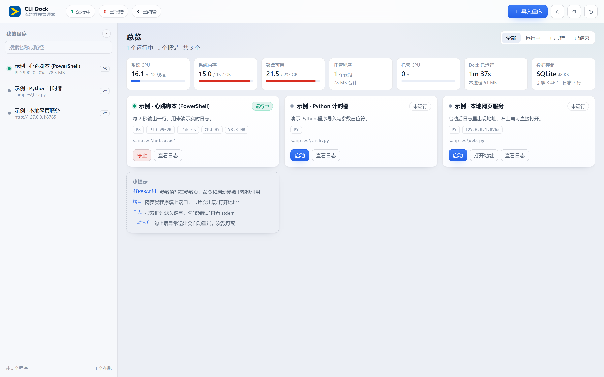

# CLI Dock

[English](README.md) | **简体中文**

把平时散落一地的命令行程序（PowerShell / Python / 批处理 / exe / 任意命令行）集中管起来的本地工具：一个总览面板、实时日志、参数占位符、计划任务、负载与托盘常驻。界面像 Docker Desktop，但管的是你本机的脚本。



- **零 npm 依赖**：只用 Node 内置模块，拷过去就能跑，不用 `npm install`
- **Windows 10/11**；界面是 Edge 的应用窗口（没有 Edge 时退回默认浏览器）
- 数据存 **SQLite**（`data\cli-dock.db`），SQLite 组件缺失时自动退回 JSON，功能不受影响

## 功能

| 能力 | 说明 |
| --- | --- |
| 程序管理 | 导入 `.ps1` / `.py` / `.cmd` / `.exe` / 自定义命令行，记住路径、参数、工作目录、环境变量 |
| 参数占位符 | 参数里写 `{{PORT}}`，界面上单独填值，改参数不用改脚本 |
| 状态区分 | **正常结束**（退出码 0）/ **异常退出**（非 0）/ **手动停止**，三者不会混 |
| 计划任务 | 每隔一段时间 / 每天固定时间 / **每周指定几天 + 时间** / 指定时间跑一次 |
| 实时日志 | 边跑边看，OUT/ERR 分色，支持搜索与历史运行日志 |
| 负载看板 | 整机 CPU、内存、磁盘可用、托管程序的数量与合计 CPU/内存、Dock 自身占用 |
| 快捷访问 | 网页类程序填好端口，卡片上直接「打开地址」；日志里出现 `http://...` 也会自动识别 |
| 托盘常驻 | 关窗口不退出，托盘右键可重新打开面板 / 停止全部 / 退出 |
| 自动重启 | 异常退出后按次数与间隔自动重试（可关） |
| 中文 / English | 设置里一键切换，界面、提示、托盘菜单、系统日志行一起变 |

## 快速开始

1. 下载本仓库（`Code → Download ZIP`），解压到**有写权限的目录**（别放 `C:\Program Files`，程序要在自己旁边写 `data\`）
2. 双击 **`CLI-Dock.exe`**（或 `Launch.cmd`，两者等价）
3. 首次启动会检查环境：没有 Node.js 就自动装一份（免管理员），没有 SQLite 组件就自动下载；然后浏览器窗口打开面板

命令行方式（排查问题更方便，能看到启动过程）：

```
CLI-Dock.exe                 打开面板
CLI-Dock.exe -stop           停止服务和托盘
CLI-Dock.exe -Port 7900      换端口启动
CLI-Dock.exe -Port 7900 -NoWindow    只起服务，不弹界面不起托盘
```

## 目录结构

```
CLI Dock\
├─ CLI-Dock.exe         双击启动（ps12exe 打包的壳，只负责调 src\start.ps1）
├─ Launch.cmd           同上，没 exe 也能用
├─ src\                 程序和脚本都在这
│  ├─ server.js         后端（Node 内置模块，零依赖）
│  ├─ public\           前端（原生 HTML/CSS/JS，无构建）
│  ├─ samples\          3 个示例程序
│  ├─ lib\              SQLite 组件（缺了会自动下载，不必提交到仓库）
│  └─ *.ps1             启动器 / 托盘 / 停止 / 环境准备 / 数据库代理
├─ data\                运行数据（数据库、日志、生成的脚本；首次启动自动创建）
└─ icon\                Logo 源文件（svg / ico）
```

**升级不会碰到数据**：替换 `src\` 与 `CLI-Dock.exe` 即可，`data\` 保持不动；备份时只拷 `data\` 就够。

## 导入一个程序

点 `＋导入程序` → 选文件（或直接填命令）→ 确认运行时类型。

| 字段 | 说明 |
| --- | --- |
| 程序路径 / 命令 | 支持 `C:\x\x.ps1`、`~\Downloads\x.ps1`、`samples\x.ps1` 三种写法（见下） |
| 启动参数 | 支持 `{{参数名}}` 占位，例如 `-Env {{ENV}} -DryRun` |
| 工作目录 | 留空则用脚本所在目录 |
| 访问端口 | 可选，网页类程序填了才有「打开地址」 |
| 停止方式 | 强制结束进程树（默认）或先温和退出、超时再强制 |
| 自动启动 / 自动重启 | 打开 CLI Dock 时自动拉起 / 异常退出后重试 |

### 路径的三种写法

| 写法 | 含义 | 适合 |
| --- | --- | --- |
| `samples\x.ps1` | 相对 CLI Dock 目录 | 脚本跟着程序走，整夹搬到哪里都能用 |
| `~\Downloads\x.ps1` | 用户目录 | 换机器换了用户名也仍然有效 |
| `C:\tools\x.ps1` | 绝对路径 | 原样使用 |

保存时会自动转换（本目录内 → 相对路径；用户目录内 → `~\...`；其它盘符 → 保持绝对）。路径找不到时卡片会**划红线**并提示「路径失效」，点开改路径即可，参数和计划都不用重填。

## 状态语义

| 状态 | 含义 |
| --- | --- |
| 运行中 | 进程活着 |
| 正常结束 | 退出码 0。定时跑一轮就退出的任务属于这种，**不算报错** |
| 异常退出 | 退出码非 0（界面上会显示退出码） |
| 已停止 | 你手动点了「停止」 |
| 重启中 | 异常退出后正在按策略自动重试 |

## 计划任务

详情页 →「计划」页签：

| 触发方式 | 说明 |
| --- | --- |
| 每隔一段时间 | 秒 / 分钟 / 小时，例如每 30 分钟 |
| 每天固定时间 | 24 小时制，多个用逗号分隔，例如 `08:30, 17:30` |
| 每周指定几天 + 时间 | 勾选星期几（可多选）+ 一个或多个时间，例如每周二、周五 `09:00, 18:30` |
| 指定时间，只跑一次 | 到点跑一次，跑完自动关闭计划 |

规则：

- 到点时程序还在跑，这一次**跳过**，不会叠加实例
- 单次任务的时间已经过去时**不会补跑**（避免重启控制台时突然执行重要任务）
- 周计划按本机时区计算，跨周自动顺延
- 计划不依赖 Windows 任务计划程序：CLI Dock 没在运行时计划不会触发

## 托盘

- 启动后任务栏右侧出现图标；菜单：**打开面板 / 在浏览器中打开 / 停止所有运行中的程序 / 退出**
- 双击图标 = 打开面板
- 关掉窗口只是关界面，**程序还在后台跑**；要全停用托盘「退出」或 `CLI-Dock.exe -stop`
- 托盘日志在 `data\tray.log`

## 语言（中文 / English）

右上角 `⚙ 设置` → **界面语言**，选 `中文` 或 `English`：

- 选完立刻生效，不用重启，也不用重新打开窗口
- 存在程序自己的设置里（跟 `data\` 走），不是浏览器缓存，所以换个窗口、拷到别的机器仍然是同一种语言
- 一起变的还有：托盘右键菜单与悬停提示（3 秒内跟上）、程序日志里的系统行（`▶ 启动命令` / `✔ 正常结束` …）、接口报错、目录快捷方式名
- 「上一次运行的历史日志」是当时写下的原文，不随语言重写
- 想临时看另一种语言（不改设置）可以加参数：`http://127.0.0.1:7811/?lang=en`

## 日志

- 详情页「日志」页签实时刷新（OUT 白 / ERR 红 / 系统行高亮），支持关键字搜索
- 每次运行的原始文本在 `data\logs\app_<id>-<时间戳>.log`，保留最近 30 次
- 同样的内容也会写进数据库的 `log_lines` 表，可用 `GET /api/db/logs?appId=…&limit=200` 查历史
- PowerShell 子进程输出强制 UTF-8；如果你的脚本是「UTF-8 无 BOM 且含中文」，启动前会给出 ⚠ 提示

## 快捷访问

- 填了端口：卡片出现「打开地址」，地址是 `http://127.0.0.1:<端口>`
- 没填端口也行：日志里第一次出现 `http://...` 会被自动识别并显示出来

## 数据

主存储是 SQLite（`data\cli-dock.db`）：

| 表 | 内容 |
| --- | --- |
| `apps` | 程序定义、参数值、计划、最近运行记录 |
| `settings` | Python / PowerShell 路径、停止宽限期、是否采集负载 |
| `runs` | 每次运行一行：状态、退出码、起止时间、触发方式 |
| `log_lines` | 所有输出行，超过 20 万行自动只留最近的 |

- **自动迁移**：如果目录里有旧版的 `data\config.json`，首次启动会把它导入数据库并备份为 `config.json.migrated-backup`
- **降级**：SQLite 组件不可用（下载失败 / DLL 加载失败）时自动改用 `data\config.json`，总览页的「数据存储」磁贴会显示 `JSON 降级` 及原因
- 直接查库：

```
powershell -File src\db-host.ps1 -Db data\cli-dock.db -Request '{"id":1,"op":"query","sql":"select name,status from runs order by id desc limit 10"}'
```

## 复制到别的机器

整个文件夹拷过去就能用，前提只有两个：

1. **Windows 10/11**（托盘用 WinForms，停止用 `taskkill`）
2. **放在有写权限的目录**（程序要建 `data\`）

Node.js 与 SQLite 组件都不必预装：缺失时自动获取（Node 走官方 zip 解压到用户目录，SQLite 走 nuget 包，都不需要管理员）。都在下载失败时会给出明确提示，程序也能用降级模式继续跑。

注意：`data\config.json` 里可能存着明文的环境变量，把文件夹分享给别人前建议先删掉 `data\`。

## 常见问题

**关掉窗口，程序还在跑吗？** 在跑，服务与托盘都在后台。要全停用托盘「退出」或 `CLI-Dock.exe -stop`。

**端口 7811 被占用**：`CLI-Dock.exe -Port 7900`，或设环境变量 `set CLIDOCK_PORT=7900` 后启动；`Launch.cmd` / 停止 / 托盘会一起生效。若该端口上是别的服务，启动器会识别出来并提示换端口，不会把别人的页面当成自己的界面打开。

**双击 exe 一闪而过**：用命令行运行 `CLI-Dock.exe` 看具体报错；常见原因是目录没有写权限、或 Node 自动安装失败（公司网络拦外网时可设 `CLIDOCK_SKIP_NODE_INSTALL=1` 后自己装）。

**总览显示「JSON 降级」**：SQLite 组件没装成功。看磁贴的悬停提示；也可以手动把官方 NuGet 包 `Stub.System.Data.SQLite.Core.NetFramework` 里的三件套放到 `src\lib\`（`lib\net46\System.Data.SQLite.dll` → `src\lib\`，`build\net46\x64\SQLite.Interop.dll` → `src\lib\x64\`，`build\net46\x86\SQLite.Interop.dll` → `src\lib\x86\`），再运行 `powershell -File src\lib-init.ps1` 验证。

**脚本参数绑定报错（比如 ValidateRange）**：检查「启动参数」是否填了不该填的值。启动器会把 `-Name value` / `-Switch` / `-Name:value` 正确转成具名参数，参数为空时不会塞空值。

**Python 找不到**：设置里把 Python 改成 `py` 或绝对路径。

**托盘图标不见了**：先看 `data\tray.log`；也可能是被 Windows 收进了「隐藏的图标」折叠区。

## 技术说明

- 后端 `src\server.js`：Node 内置模块（http / fs / child_process），SSE 推送状态，无框架
  - `GET /api/state`、`GET /api/events`（SSE）
  - `POST /api/apps`、`DELETE /api/apps/:id`、`POST /api/apps/:id/{start|stop|restart|values|schedule}`
  - `GET /api/apps/:id/tail?since=N`、`GET /api/log?file=…`、`GET /api/browse?dir=…`、`GET /api/db/logs`
  - `POST /api/settings`、`POST /api/shutdown`
- 前端 `src\public\`：原生 HTML/CSS/JS，无构建步骤，明亮/深色主题
- 进程：`spawn` + 独立 stdout/stderr 管道，按行解码（UTF-8 失败回退 GBK）；停止用 `taskkill /T /F` 结束整棵树
- 计划器：10 秒一跳的内存调度，`nextRunAt` 在界面可见
- 托盘：`tray.ps1` + WinForms NotifyIcon（`Application::Run()` 消息泵）
- 负载：常驻 `metrics.ps1`，2 秒一采样，服务端没心跳就自己退出
- 存储：`db-client.js`（Node 侧队列与批量写）+ `db-host.ps1`（常驻 PowerShell 持有 SQLite 连接）
- 环境准备：`node-env.ps1`（Node 查找/安装）、`lib-init.ps1`（SQLite 组件下载与加载校验）

## 自己打包 exe

用 [ps12exe](https://github.com/MScholtes/PS2EXE)（PowerShell 模块）：

```
Install-Module ps12exe -Scope CurrentUser -Force

$res = @{
  iconFile = 'icon\cli-dock.ico'
  title = 'CLI Dock'; description = '本地命令行程序管理器'
  product = 'CLI Dock'; version = '1.3.0.0'
}
ps12exe -InputFile 'src\launcher.ps1' -OutputFile 'CLI-Dock.exe' `
        -resourceParams $res -architecture anycpu -supportOS
```

exe 里只有 30 多行启动壳，逻辑都在 `src\`，所以改脚本不用重新打包。

## 许可证

[MIT](LICENSE) © 2026 Kahn Zhang
